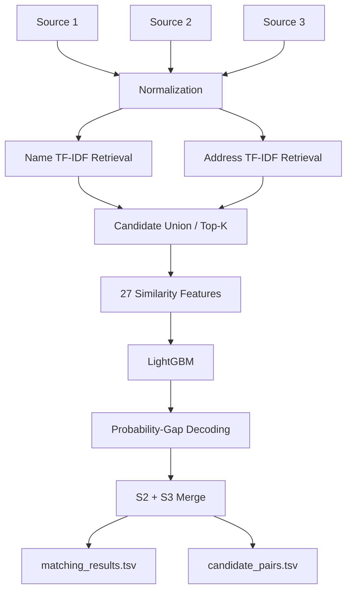

# ML Challenge 26 — Business Entity Resolution

## Problem Statement

Business identity data arrives from three independent sources — Source 1
(the deduplicated reference source), Source 2, and Source 3 — each with
noisy, inconsistent name and address fields and no shared identifiers. The
task: for every Source 1 entity, find all matching records in Source 2 and
Source 3 (an entity may match zero, one, or many records in each). Full
field-level format and noise-pattern details are in
[`PROBLEM_STATEMENT.md`](PROBLEM_STATEMENT.md).

## Approach

Three sources of noise dominate this dataset: name variation (legal-suffix
abbreviations, punctuation, transliteration), address variation (abbreviated
street types, missing components, landmark references), and sheer scale
(millions of records per source, so no all-pairs comparison is feasible).

The final pipeline handles this in four stages:

1. **Normalize** every record's name and address into comparable canonical
   forms (folded legal suffixes, expanded abbreviations, tokenized fields).
2. **Retrieve** a small, high-recall candidate set per Source-1 entity using
   two inverted indexes (name tokens, address tokens) with IDF-weighted
   scoring — not a rule-based blocking join, and not a brute-force
   all-pairs TF-IDF cosine (both were tried first; see
   [Results](#results) and `code/business_entity_resolution/EXPERIMENTS.md`).
3. **Score** every retrieved candidate with a LightGBM model over 27
   hand-engineered similarity features (exact-match flags, token overlap,
   edit distance, address-component equality).
4. **Decode** matches per entity via probability-gap thresholding, then
   merge the Source-2 and Source-3 results into the submission files.

## Architecture



## Results

| Approach | Leaderboard F0.5 |
|---|---:|
| Rule-based / deterministic blocking baseline | ~0.540 |
| **TF-IDF retrieval + LightGBM (final)** | **0.809** |

### Retrieval recall (validated on an 8,000-entity training sample, full
target corpus, against `train_ground_truth.tsv`)

| View | S2 recall | S3 recall |
|---|---:|---:|
| Name TF-IDF alone | 52.4% | 50.6% |
| Address TF-IDF alone | 87.2% | 81.3% |
| **Name + Address combined** | **93.65%** | **90.88%** |

Combined recall ≈ 92.2% overall (vs. ~81.5% for the earlier rule-based
blocking), at ≈ 29 candidates/entity on average.

**Final decoding:** probability threshold = 0.75, probability gap = 0.10.

## Tech Stack

- **DuckDB** — out-of-core SQL over Parquet for normalization, candidate
  scoring joins, and submission-file merges
- **PyArrow** — streaming Parquet I/O and zero-copy table slicing
- **NumPy** — vectorized inverted-index scoring (concatenate + unique +
  bincount, never a dense per-query array)
- **rapidfuzz** — C-implemented byte-level Levenshtein distance
- **LightGBM** — the pairwise match/no-match classifier
- **Python `concurrent.futures.ProcessPoolExecutor`** — parallel feature
  computation and scoring

## Repository Structure

```
ML_CHALLENGE_26/
│
├── output/
│   ├── matching_results.tsv
│   └── candidate_pairs.tsv
│
├── code/
│   └── business_entity_resolution/
│       ├── src/
│       ├── README.md              (final-pipeline technical documentation)
│       ├── EXPERIMENTS.md         (earlier blocking approach + experiments)
│       └── requirements.txt
│
├── Documentation_template.md
├── PROBLEM_STATEMENT.md
├── README.md                       (this file)
└── .gitignore
```

## Reproduction

See [`code/business_entity_resolution/README.md`](code/business_entity_resolution/README.md)
for the exact stage-by-stage commands used to reproduce
`output/matching_results.tsv` and `output/candidate_pairs.tsv` from the raw
dataset.
